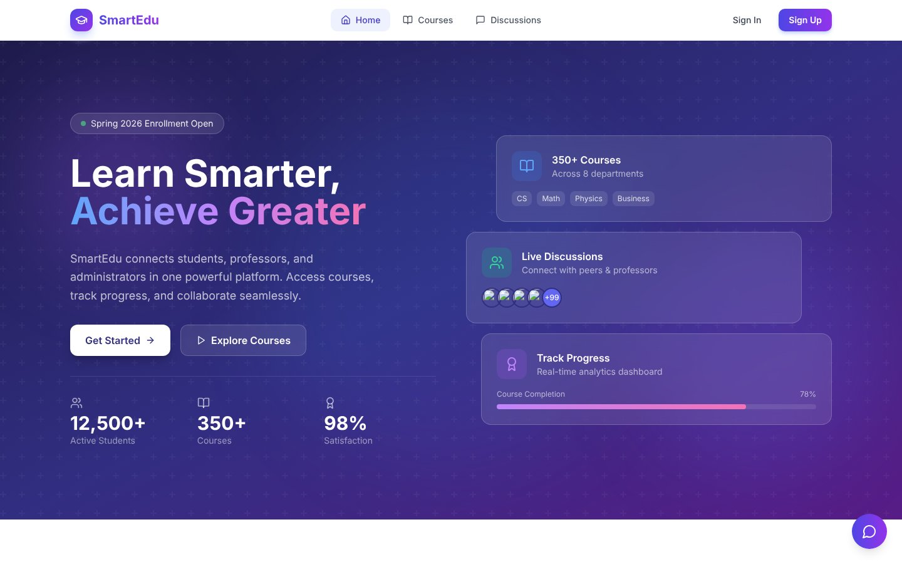
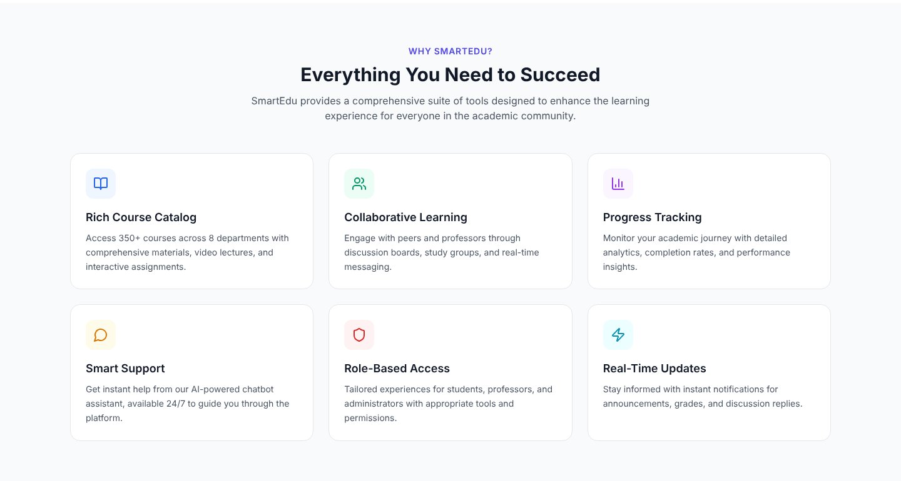

# SmartEdu — Plateforme éducative multi-rôles

> *Multi-role university learning platform (students, professors, admins) — React, TypeScript, Supabase/PostgreSQL.*

SmartEdu réunit étudiants, professeurs et administrateurs sur une même plateforme : catalogue de cours, inscriptions et suivi de progression, forum de discussion, tableau de bord professeur et assistant (chatbot) intégré.



## Fonctionnalités

| Rôle | Ce qu'il peut faire |
|---|---|
| **Étudiant** | Parcourir le catalogue, s'inscrire / se désinscrire à un cours, suivre sa progression, participer aux discussions |
| **Professeur** | Créer et supprimer des cours, ajouter des modules et des annonces, consulter les statistiques d'engagement et la répartition des notes (graphiques Recharts) |
| **Administrateur** | Voit et gère l'ensemble des cours de tous les professeurs, crée des espaces de discussion |
| **Tous** | Authentification (inscription / connexion), profil et avatar, chatbot d'aide guidé |



## Stack technique

- **Frontend** : React 18, TypeScript, Vite, Tailwind CSS, shadcn/ui (Radix UI), React Query, Recharts
- **Backend** : Supabase — PostgreSQL, authentification, contrôle d'accès par rôle
- **Déploiement** : AWS EC2 (Ubuntu 22.04) avec Nginx en reverse proxy

## Modèle de données

Tables PostgreSQL utilisées par l'application (`src/lib/database.ts`) :

| Table | Rôle |
|---|---|
| `profiles` | Utilisateur, rôle (`student` / `professor` / `admin`), avatar |
| `courses` | Cours (code, département, semestre, crédits, capacité, niveau) |
| `course_modules` | Modules ordonnés d'un cours |
| `announcements` | Annonces publiées par le professeur |
| `enrollments` | Inscriptions étudiant ↔ cours et progression |
| `discussions` / `discussion_replies` | Forum : sujets, réponses, likes |

## Lancer le projet

```bash
npm install
cp .env.example .env   # renseigner l'URL et la clé anon de votre projet Supabase
npm run dev            # http://localhost:8080
```

Sans fichier `.env`, l'interface reste navigable en mode démo (sans données distantes).

```bash
npm run build          # build de production dans dist/
```

## Structure

```
src/
├── components/        # Navbar, Hero, CourseCatalog, CourseDetail, Discussion,
│                      # ProfessorDashboard, UserProfile, Chatbot, ui/ (shadcn)
├── contexts/          # AuthContext (session, rôle, inscriptions), AppContext
├── lib/               # supabase.ts (client), database.ts (requêtes typées)
├── data/              # Contenus statiques (scénario du chatbot, données de démo)
└── pages/             # Index, NotFound
```

## Ce que j'ai appris

- Concevoir un contrôle d'accès par rôle côté base de données et côté interface
- Typer toute la couche d'accès aux données en TypeScript
- Corriger une *race condition* entre le chargement de la session et les requêtes au backend
- Déployer une application React sur un serveur Linux (EC2, Nginx, SSH, security groups)

---

Projet académique — TED University, 2025–2026 · **Emna Zarati** · [LinkedIn](https://www.linkedin.com/in/emna-zarati-30955937b)

*Projet réalisé en binôme avec Luca Raciti ([GitHub](https://github.com/RacitiLuca)).*
